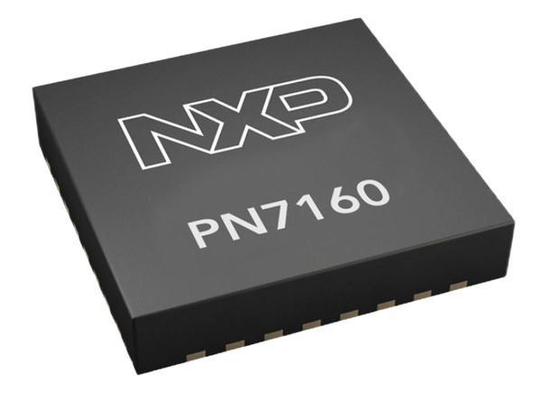

# PN7160
Library/Driver for NXP PN7160 NFC device : https://www.nxp.com/products/rfid-nfc/nfc-hf/nfc-readers/nfc-plug-and-play-controller-with-integrated-firmware-and-nci-interface:PN7160


![Built with PlatformIO](https://img.shields.io/badge/built%20with-PlatformIO-orange?logo=data%3Aimage%2Fsvg%2Bxml%3Bbase64%2CPHN2ZyB3aWR0aD0iMjUwMCIgaGVpZ2h0PSIyNTAwIiB2aWV3Qm94PSIwIDAgMjU2IDI1NiIgeG1sbnM9Imh0dHA6Ly93d3cudzMub3JnLzIwMDAvc3ZnIiBwcmVzZXJ2ZUFzcGVjdFJhdGlvPSJ4TWlkWU1pZCI+PHBhdGggZD0iTTEyOCAwQzkzLjgxIDAgNjEuNjY2IDEzLjMxNCAzNy40OSAzNy40OSAxMy4zMTQgNjEuNjY2IDAgOTMuODEgMCAxMjhjMCAzNC4xOSAxMy4zMTQgNjYuMzM0IDM3LjQ5IDkwLjUxQzYxLjY2NiAyNDIuNjg2IDkzLjgxIDI1NiAxMjggMjU2YzM0LjE5IDAgNjYuMzM0LTEzLjMxNCA5MC41MS0zNy40OUMyNDIuNjg2IDE5NC4zMzQgMjU2IDE2Mi4xOSAyNTYgMTI4YzAtMzQuMTktMTMuMzE0LTY2LjMzNC0zNy40OS05MC41MUMxOTQuMzM0IDEzLjMxNCAxNjIuMTkgMCAxMjggMCIgZmlsbD0iI0ZGN0YwMCIvPjxwYXRoIGQ9Ik0yNDkuMzg2IDEyOGMwIDY3LjA0LTU0LjM0NyAxMjEuMzg2LTEyMS4zODYgMTIxLjM4NkM2MC45NiAyNDkuMzg2IDYuNjEzIDE5NS4wNCA2LjYxMyAxMjggNi42MTMgNjAuOTYgNjAuOTYgNi42MTQgMTI4IDYuNjE0YzY3LjA0IDAgMTIxLjM4NiA1NC4zNDYgMTIxLjM4NiAxMjEuMzg2IiBmaWxsPSIjRkZGIi8+PHBhdGggZD0iTTE2MC44NjkgNzQuMDYybDUuMTQ1LTE4LjUzN2M1LjI2NC0uNDcgOS4zOTItNC44ODYgOS4zOTItMTAuMjczIDAtNS43LTQuNjItMTAuMzItMTAuMzItMTAuMzJzLTEwLjMyIDQuNjItMTAuMzIgMTAuMzJjMCAzLjc1NSAyLjAxMyA3LjAzIDUuMDEgOC44MzdsLTUuMDUgMTguMTk1Yy0xNC40MzctMy42Ny0yNi42MjUtMy4zOS0yNi42MjUtMy4zOWwtMi4yNTggMS4wMXYxNDAuODcybDIuMjU4Ljc1M2MxMy42MTQgMCA3My4xNzctNDEuMTMzIDczLjMyMy04NS4yNyAwLTMxLjYyNC0yMS4wMjMtNDUuODI1LTQwLjU1NS01Mi4xOTd6TTE0Ni41MyAxNjQuOGMtMTEuNjE3LTE4LjU1Ny02LjcwNi02MS43NTEgMjMuNjQzLTY3LjkyNSA4LjMyLTEuMzMzIDE4LjUwOSA0LjEzNCAyMS41MSAxNi4yNzkgNy41ODIgMjUuNzY2LTM3LjAxNSA2MS44NDUtNDUuMTUzIDUxLjY0NnptMTguMjE2LTM5Ljc1MmE5LjM5OSA5LjM5OSAwIDAgMC05LjM5OSA5LjM5OSA5LjM5OSA5LjM5OSAwIDAgMCA5LjQgOS4zOTkgOS4zOTkgOS4zOTkgMCAwIDAgOS4zOTgtOS40IDkuMzk5IDkuMzk5IDAgMCAwLTkuMzk5LTkuMzk4em0yLjgxIDguNjcyYTIuMzc0IDIuMzc0IDAgMSAxIDAtNC43NDkgMi4zNzQgMi4zNzQgMCAwIDEgMCA0Ljc0OXoiIGZpbGw9IiNFNTcyMDAiLz48cGF0aCBkPSJNMTAxLjM3MSA3Mi43MDlsLTUuMDIzLTE4LjkwMWMyLjg3NC0xLjgzMiA0Ljc4Ni01LjA0IDQuNzg2LTguNzAxIDAtNS43LTQuNjItMTAuMzItMTAuMzItMTAuMzItNS42OTkgMC0xMC4zMTkgNC42Mi0xMC4zMTkgMTAuMzIgMCA1LjY4MiA0LjU5MiAxMC4yODkgMTAuMjY3IDEwLjMxN0w5NS44IDc0LjM3OGMtMTkuNjA5IDYuNTEtNDAuODg1IDIwLjc0Mi00MC44ODUgNTEuODguNDM2IDQ1LjAxIDU5LjU3MiA4NS4yNjcgNzMuMTg2IDg1LjI2N1Y2OC44OTJzLTEyLjI1Mi0uMDYyLTI2LjcyOSAzLjgxN3ptMTAuMzk1IDkyLjA5Yy04LjEzOCAxMC4yLTUyLjczNS0yNS44OC00NS4xNTQtNTEuNjQ1IDMuMDAyLTEyLjE0NSAxMy4xOS0xNy42MTIgMjEuNTExLTE2LjI4IDMwLjM1IDYuMTc1IDM1LjI2IDQ5LjM2OSAyMy42NDMgNjcuOTI2em0tMTguODItMzkuNDZhOS4zOTkgOS4zOTkgMCAwIDAtOS4zOTkgOS4zOTggOS4zOTkgOS4zOTkgMCAwIDAgOS40IDkuNCA5LjM5OSA5LjM5OSAwIDAgMCA5LjM5OC05LjQgOS4zOTkgOS4zOTkgMCAwIDAtOS4zOTktOS4zOTl6bS0yLjgxIDguNjcxYTIuMzc0IDIuMzc0IDAgMSAxIDAtNC43NDggMi4zNzQgMi4zNzQgMCAwIDEgMCA0Ljc0OHoiIGZpbGw9IiNGRjdGMDAiLz48L3N2Zz4=)

[](https://codecov.io/gh/Strooom/PN7160)
[](https://creativecommons.org/licenses/by-nc-sa/4.0/)
[](https://sonarcloud.io/summary/new_code?id=Strooom_PN7160)

All documentation is in the Repository Wiki : https://github.com/Strooom/PN7160/wiki




## ESP32 Arduino I2C transport

An ESP32-specific transport is selected by `ARDUINO_ARCH_ESP32`. The existing
initialization API remains available; an additional overload accepts a shared
`TwoWire` instance, explicit SDA/SCL, IRQ/VEN, address and bus clock:

```cpp
#include <Wire.h>
#include "pn7160interface/pn7160interface.hpp"
#include "nci/nci.hpp"

bool ready = false;
void setup() {
    // Adjust every pin for the actual reader and board.
    ready = PN7160Interface::initialize(Wire, 14, 13, 0x28, 21, 22, 400000);
    if (ready) nci::reset();
}
void loop() {
    if (ready) nci::run();
}
// PN7160Interface::initialize(14, 13) also works with Wire's default pins.
```

Initialization reserves a 258-byte Wire buffer for the three-byte NCI header
and maximum 255-byte payload, sets a 20 ms I2C timeout, checks bus setup, and
configures IRQ/VEN. Writes report short transfers and failed acknowledgements.
Reads check the complete header and payload before publishing the header; a
failed read clears the header so the NCI engine cannot reuse a previous reply.
Wake-up probes use the existing bounded retry count/delay.

The caller owns the supplied bus and must keep it alive. The driver never calls
`Wire.end()`. Other users must agree on pins, clock, timeout and buffer settings.
The transport and NCI engine are static and support one reader; serialize calls
and initialization externally. This adds an I2C platform port, not a new reader
facade or additional NFC protocol implementation.

The previous RP2040, Teensy and generic transport code remains in its original
branch. This change is based on upstream `RP2040`, which already contains the
reusable library layout and RP2040 support.

Run `python3 test/esp32/run.py` for host-side regression tests with AddressSanitizer
and UndefinedBehaviorSanitizer. They compile the actual transport and NCI engine
against simulated Arduino/Wire APIs, covering ESP32 initialization, bus selection,
maximum packets, transfer failures, UID discovery/repeats/removal, and the existing
initialization API. A separate executable checks the legacy RP2040 transport
branch. These are simulated API tests; real SDK builds, electrical behavior and
RF timing still require validation on the target hardware.
